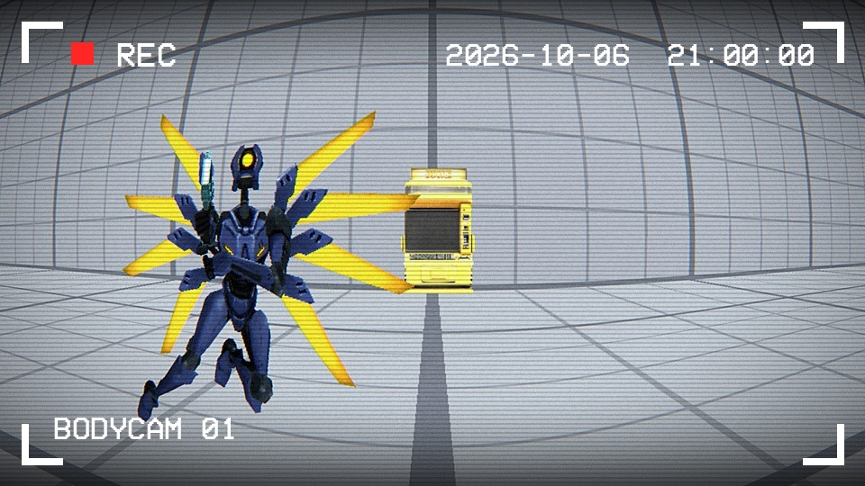

# Ultrakill-PVP

PVP mod for ULTRAKILL. Fight other players with every weapon and arm in the game, with or without Steam.



## Installation

1. Download the latest zip from [Releases](https://github.com/Giaxeri/Ultrakill-PVP/releases).
2. In Steam, right-click ULTRAKILL > Manage > Browse local files.
3. Extract everything from the zip into that folder, next to `ULTRAKILL.exe`.
4. Start the game. There's a new PVP button in the main menu.

Already using BepInEx? Just put the zip's `BepInEx/plugins/Ultrakill-PVP` folder in your plugins folder.
Keep `Ultrakill-PVP.dll` and `EOSSDK-Win64-Shipping.dll` together. With r2modman, Gale or the Thunderstore Mod Manager,
you can also get it from Thunderstore, but that version only uses Steam lobbies (see below).

Everyone in a lobby needs the same version. When there's a new one, the game tells you as you press PVP: UPDATE
installs it for you, GITHUB opens the download page if you'd rather do it by hand, and DISCORD opens the server.

Mods that change health, movement, weapons, damage, parries or the game speed can't be used in PVP. When you press
PVP the game lists them; turn them off in your mod manager (or take their files out of BepInEx) and restart the game.
Visual mods are fine. The mod never changes or deletes other mods' files.

## Lobbies

The LOBBY panel has EPIC and STEAM at the top. EPIC (the default) uses Epic Online Services, so everyone with this
version plays together, with or without Steam. STEAM uses Steam lobbies, the same ones the Thunderstore version uses,
so you can also play with those players. You can switch when you are not in a lobby; the mod remembers your choice
(`Network` in the config file). If Epic can't start, the mod uses Steam lobbies.

In the lobby list the host can KICK a player (click twice; they can only come back with an invite), and anyone can
MUTE a player's chat. If the host leaves, the match goes on with a new host. Cheats are off on PVP maps unless the
host turns on ALLOW CHEATS in PVP OPTIONS.

## Custom levels

With [Angry Level Loader](https://thunderstore.io/c/ultrakill/p/EternalsTeam/AngryLevelLoader/) installed, MAPS has a
CUSTOM LEVELS tab with the levels you have in it. LOAD LEVEL FILE adds a .angry file someone sent you. The host picks
one and everyone in the lobby goes there, in VERSUS.
Everyone needs the same level file: a player who doesn't have it, or has another version, gets a message saying which
level to get and stays out. Enemies, arenas and the end of the level are turned off. Levels that need scripts only
load if their scripts are signed.

Level makers: put empty objects named `PVP Spawn` (`PVP Spawn 1`, `PVP Spawn 2`...) where players should appear; their
rotation is the way they face. Without them the mod picks spawn points on the level's floor.

## Online and privacy

- Epic lobbies go through Epic Online Services. When the main menu opens, the mod logs in to Epic with an anonymous
  account tied to your PC (no Epic account needed). It doesn't join any lobby until you press PVP and create or join
  one. To only log in after you press PVP, set `Connect at startup = false` in `BepInEx/config/giaxeri.ultrakill.pvp.cfg`.
- In an Epic lobby, the other players see your name, your profile picture and your V1 look. Your SteamID is not shared
  as plain text: the lobby only gets a code made from it, so your Steam friends can tell you are already in it when
  they invite people. Traffic between players goes through Epic's relays, so nobody sees your IP address.
- In a Steam lobby (STEAM picked, or Epic couldn't start), the people in it can see your Steam name, avatar and Steam
  ID, like in any Steam lobby, plus your V1 look. Traffic goes through Steam's relays (Steam Datagram Relay), so nobody sees your
  IP address there either.
- On start the mod asks GitHub if there's a newer version (you can turn it off in the same config file). There's no
  player count and no analytics. Nothing else is sent anywhere.

## Verify your download

Each release lists the SHA-256 of its zip, and GitHub also shows it next to the file. To compare, run this in
PowerShell in the folder with the zip:

```
Get-FileHash Ultrakill-PVP-V-x.zip
```

The in-game UPDATE only installs a release whose signed manifest matches (RSA-3072). The public key is
[`upvp-update.pub`](upvp-update.pub) in this repo.

## Security

When you host, the mod warns you if a player keeps taking hits without losing any health (god mode). Set
`Kick god mode = true` in `BepInEx/config/giaxeri.ultrakill.pvp.cfg` to kick them instead.

Found a security problem? See [SECURITY.md](SECURITY.md) to report it privately.

## Discord

https://discord.gg/MtmMgxhCC Feedback received!

## Controls

| Key | Action |
|-----|--------|
| T | Chat, anywhere while you are in a lobby (you can change it in OPTIONS > CONTROLS) |
| F1 | Hide the HUD |
| F2 | Preparation: vote START NOW |
| F1 / F2 | Vote yes / no when the host asks to go back to the waiting hall |
| F3 | Teams: pick or change your team (VERSUS, when the round has teams; you can also click a team) |
| Mouse, click or 1-9 | Votes on the tablet (map, waiting hall mode and teams, ARMS RACE music): point and tap |
| Left / Right, Enter | Host, MATCH OPTIONS: change the number for the mode, DONE |
| F6 | Steam invite (also in the pause menu) |
| F7 | Leave the lobby |
| F9 | Put the mirror dummy in front of you |
| F10 | Freeze the mirror dummy |
| F11 | Sparring: the mirror dummy's projectiles hurt you |
| Punch right before a hit | Parry (Feedbacker; the Knuckleblaster only with KNUCKLEBLASTER PARRY on in PVP OPTIONS) |
| Mash whiplash | Win a whiplash clash |
| 1-5, 0 | ARMS RACE music vote: 1-4 a song, 5 REROLL, 0 no music |
| Left / Right, mouse wheel | MAPS: turn the carousel (or click a map, or the small pictures under it) |
| :name: in the chat | An emoji, like :sob:, :skull: or :fire: (pasting emojis works too) |

To spectate, turn off PVP ENABLED in the pause menu, or pick SPECTATE in the teams panel. Fly with the movement keys
and the mouse (Jump / Slide go up and down, Dash or the mouse wheel change the speed). Fire and Alt fire follow the
next or previous player. In a round of FIRST TO X KILLS, TIME LIMIT or LAST ONE STANDING, going to spectate keeps you
out until the next round. Joining a match puts you in as a player, except in LAST ONE STANDING, where you spectate
until the next round.

## License

The release files (the DLL and the docs that come with it) are under the MIT license, see `LICENSE`. The source code
is not public. Epic's SDK parts and the other parts of the zip keep their own licenses, and the sounds' credits are
there too: see `THIRD_PARTY_NOTICES.md`.
